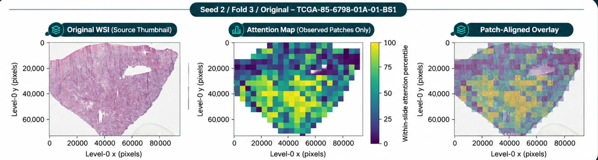
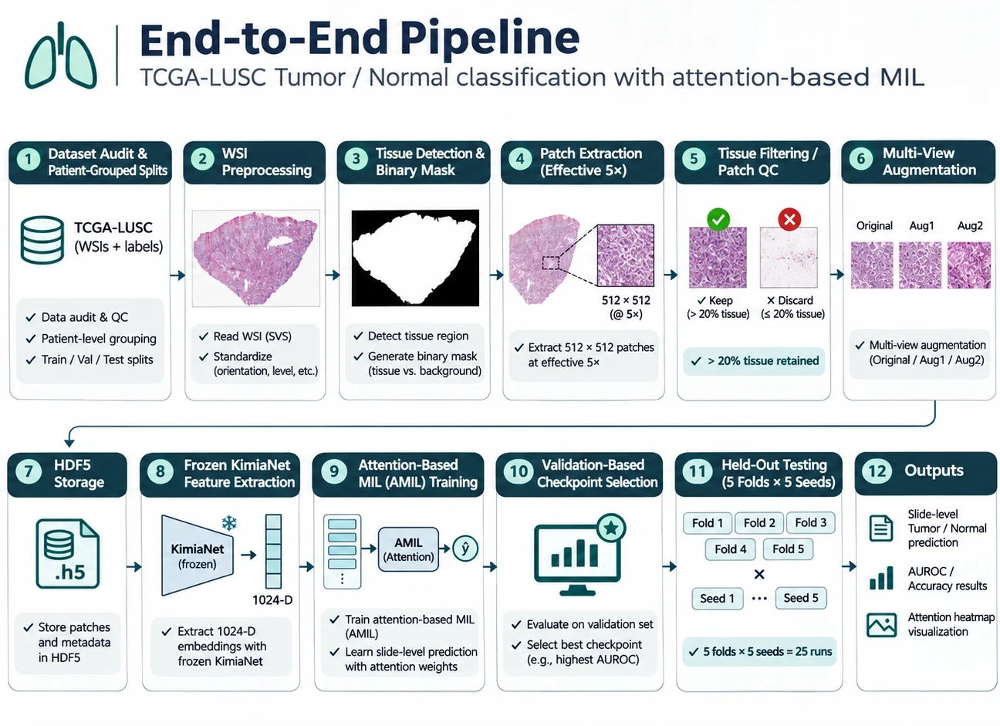
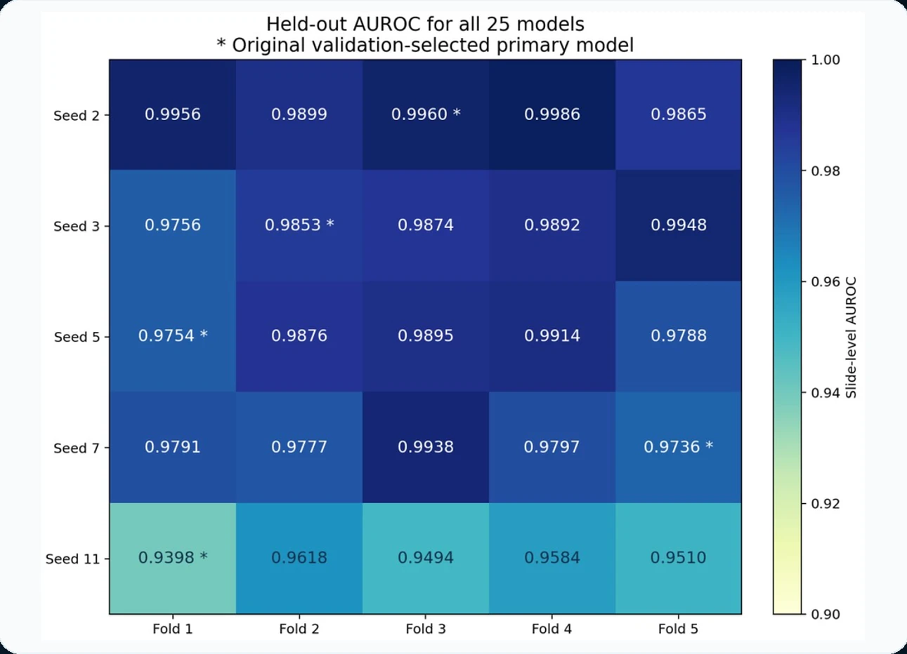

# Tumor-Detection

**Reproducible binary Tumor / Normal classification for TCGA-LUSC whole-slide images using frozen KimiaNet features and attention-based multiple instance learning (AMIL).**

<p align="center">
  
</p>

<p align="center">
  <em>Example held-out slide visualization: source WSI, attention map over observed patches, and patch-aligned overlay.</em>
</p>

---

## Project at a glance

| Item | Description |
|---|---|
| Dataset | TCGA-LUSC |
| Task | Binary slide-level Tumor / Normal classification |
| Frozen cohort | 694 slides: 347 per class |
| Patient count | 373 patients |
| Patch size | 512 × 512 pixels |
| Effective magnification | 5× |
| Tissue filtering | Retain patches with strictly more than 20% tissue |
| Feature extractor | Frozen KimiaNet |
| Feature dimension | 1,024 |
| MIL model | Attention-based Multiple Instance Learning (AMIL) |
| Evaluation design | 5 seeds × 5 folds = 25 model runs |

Some patients contribute both Normal and Tumor tissue. **All slides and all derived views from a patient are kept in the same data partition** to prevent patient-level leakage.

## End-to-end pipeline

The figure below summarizes the implemented workflow, from cohort auditing through slide-level prediction and attention visualization.

<p align="center">
  
</p>

### Pipeline stages

1. **Dataset audit and patient-grouped splits** — audit the frozen GDC manifest, labels, patient identity, and available image evidence.
2. **WSI preprocessing** — read and standardize whole-slide images.
3. **Tissue detection** — identify tissue regions and generate binary tissue masks.
4. **Patch extraction** — extract 512 × 512 patches at effective 5× magnification.
5. **Patch quality control** — retain patches with strictly more than 20% tissue. No arbitrary slide-level patch-count cutoff is imposed.
6. **Multi-view augmentation** — create aligned Original, Aug1, and Aug2 views.
7. **HDF5 storage** — store aligned image views and metadata in lossless, chunked HDF5 files.
8. **Frozen feature extraction** — stream all three views through the genuine, frozen KimiaNet checkpoint to obtain 1,024-dimensional embeddings.
9. **AMIL training** — train attention-based MIL using view-bags, with padding removed during data loading.
10. **Validation-based model selection** — select checkpoints using validation data.
11. **Held-out evaluation** — run the five-fold × five-seed experiment.
12. **Outputs** — generate slide-level predictions, evaluation metrics, and attention visualizations.

## Held-out results

### Supplementary evaluation of all 25 models

The heatmap shows slide-level held-out AUROC for all 25 seed/fold combinations. An asterisk marks the **original validation-selected primary model for that seed**.

<p align="center">
  
</p>

| Seed | Fold 1 | Fold 2 | Fold 3 | Fold 4 | Fold 5 |
|---|---:|---:|---:|---:|---:|
| Seed 2 | 0.9956 | 0.9899 | **0.9960*** | 0.9986 | 0.9865 |
| Seed 3 | 0.9756 | **0.9853*** | 0.9874 | 0.9892 | 0.9948 |
| Seed 5 | **0.9754*** | 0.9876 | 0.9895 | 0.9914 | 0.9788 |
| Seed 7 | 0.9791 | 0.9777 | 0.9938 | 0.9797 | **0.9736*** |
| Seed 11 | **0.9398*** | 0.9618 | 0.9494 | 0.9584 | 0.9510 |

The unweighted mean of the five starred, validation-selected held-out AUROC values is **0.9740**. This is the arithmetic mean of those five fold-level values, not a pooled AUROC.

**Evaluation protocol distinction:**
- The five starred models are the primary models selected using validation performance and reported in the full-cohort experiment.
- Testing all 25 frozen checkpoints is a separate supplementary, descriptive analysis; it should not be interpreted as replacing validation-based model selection.
- Validation and test evaluation use the **Original** view only.
- The full evaluation workflow also supports AUROC/AP reporting, patient-level bootstrap analysis, and reproducible PNG/SVG reports.

### Attention visualization

The attention figure at the top of this README shows one example identified as:

`Seed 2 / Fold 3 / Original — TCGA-85-6798-01A-01-BS1`

It presents:
- the original WSI source thumbnail;
- the attention map over observed patches only; and
- a patch-aligned overlay on the source slide.

Attention values visualize the model's relative patch weighting. They are not, by themselves, proof of a specific histopathological finding or a clinical explanation.

## Data handling and leakage control

- The cohort inventory and patient-aware reference partitions are frozen and versioned in the repository.
- Slides from the same patient remain in one partition, including patients with both Normal and Tumor slides.
- Derived views from a slide follow the partition of their source patient.
- Raw WSIs, KimiaNet weights, and generated experiment artifacts remain outside Git.
- Source files, preprocessing rules, split definitions, and feature-cache provenance are checked by the audit and validation workflows.

The dataset is intended for research use. No patient-identifying information or raw clinical data should be committed to this repository.

## Installation

Use **Python 3.12** on 64-bit Linux/WSL or Windows.

### Create an environment

Linux / macOS / WSL:

```bash
python3.12 -m venv .venv
source .venv/bin/activate
python -m pip install torch==2.14.0 torchvision==0.29.0 \
  --index-url https://download.pytorch.org/whl/cpu
python -m pip install -e ".[dev]"
```

Windows PowerShell:

```powershell
py -3.12 -m venv .venv
.venv\Scripts\Activate.ps1
python -m pip install torch==2.14.0 torchvision==0.29.0 `
  --index-url https://download.pytorch.org/whl/cpu
python -m pip install -e ".[dev]"
```

Install the selected `torch` / `torchvision` wheel pair before installing the project extra. For CUDA installation, use the commands in the [AMIL environment guide](docs/workflows/amil-validation.md).

### Optional install targets

| Command | Contents |
|---|---|
| `pip install -e .` | Preprocessing dependencies |
| `pip install -e ".[audit]"` | Frozen-source and local WSI audit support |
| `pip install -e ".[augmentation]"` | Three-view transforms and image HDF5 storage |
| `pip install -e ".[mil]"` | Augmentation, feature extraction, grouped splits, and MIL |
| `pip install -e ".[dev]"` | Complete runtime, pytest, Ruff, and packaging tools |

Dependency pins are defined in `requirements/` and consumed by `pyproject.toml`. The extras combine these components without duplicating pins. Offline audit functions use the Python standard library.

## Verify the checkout

```bash
python scripts/run_quality_checks.py
python -m build
```

The quality runner checks formatting, lint, compilation, tests, frozen sources, recorded audit replay, dependency consistency, commit policy, and whitespace.

By default, quality reports are written outside the repository to:

```text
../lung-wsi-mil-outputs/quality/
```

A plain `python -m pytest` discovers the portable tests under `tests/`. Real-data and device-specific acceptance checks are explicit.

### Real-data acceptance

```bash
python scripts/validate_amil.py \
  --pilot14-h5 /external/pilot14-kimianet.h5 \
  --output ../lung-wsi-mil-outputs/amil-validation.json
```

This check requires its input file and fails if the input is missing.

## Run the pipeline

Prepare the external `Data/` directory and use a verified feature cache:

```powershell
lung-wsi-pipeline `
  --data-root 'D:\path\to\Data' `
  --run-name 'amil-reference-new' `
  --start-at features `
  --device cuda
```

Use:
- `--start-at raw` to begin from raw slides;
- `--start-at patches` to begin from preprocessed patch views; or
- `--start-at features` to begin from an existing verified feature cache.

The workflow uses the checked-in inventory, reference configuration, and patient splits. See the [pipeline workflow](docs/workflows/pipeline.md) for input layout, verification, and output details.

### Run individual stages

```bash
lung-wsi-validate-sources
lung-wsi-audit --mode recorded
lung-wsi-splits --output-dir ../lung-wsi-mil-outputs/new-splits

lung-wsi-pilot /external/pilot14 ../lung-wsi-mil-outputs/pilot14-new \
  --inventory metadata/dataset_inventory.csv \
  --selection-csv metadata/pilot14_selection.csv \
  --verify-source-md5

lung-wsi-verify-pilot ../lung-wsi-mil-outputs/pilot14-new \
  --verify-source-md5

lung-wsi-process /external/TCGA-LUSC ../lung-wsi-mil-outputs/cohort-new \
  --inventory metadata/dataset_inventory.csv \
  --workers 6 \
  --verify-source-md5

lung-wsi-extract --help
```

Commands accept `--help`. Existing `scripts/*.py` launchers remain available; importable implementations live in `lung_wsi_mil`. Older imports under `src.*` should be updated to `lung_wsi_mil.*`.

## Train and evaluate AMIL separately

Validate a feature cache and configuration:

```bash
lung-wsi-experiment validate \
  --features /external/features/full-kimianet.h5 \
  --config configs/amil-reference.json
```

Run the experiment:

```bash
lung-wsi-experiment run \
  --features /external/features/full-kimianet.h5 \
  --config configs/amil-reference.json \
  --device cuda \
  --patch-root /external/TCGA_LUSC_HDF \
  --output ../lung-wsi-mil-outputs/amil-reference
```

Use `--device cpu` with the CPU runtime. `train` and `test` can also be run separately. With `--resume`, the runner verifies and reuses the same experiment and continues interrupted epochs.

The default experiment trains all 25 models, selects checkpoints using validation only, and evaluates one frozen primary model per seed. Validation and test use Original views only. Outputs are written outside Git.

For a complete software check without real data:

```bash
lung-wsi-experiment smoke \
  --output ../lung-wsi-mil-outputs/software-smoke
```

The smoke command creates synthetic inputs and exercises the stages. **Its metrics are not real TCGA results.**

See the [experiment protocol and server commands](docs/workflows/experiments.md) and the [reference configuration](configs/amil-reference.json).

## Repository structure

```text
.
├── src/lung_wsi_mil/       # Installable audit, augmentation, data, features,
│                           # MIL, preprocessing, and workflow modules
├── scripts/                # Compatibility launchers and quality/acceptance tools
├── tests/                  # Portable tests and optional real-data/device checks
├── metadata/source/        # Byte-preserved frozen source documents
├── metadata/               # Cohort inventory and recorded evidence summaries
├── splits/                 # Frozen patient-aware reference partitions
├── configs/                # Explicit experiment defaults
├── requirements/           # Pinned dependency components
├── docs/                   # Architecture, workflows, results, and development notes
└── assets/                 # README figures
```

Additional project documentation:
- [Documentation index](docs/README.md)
- [AMIL validation guide](docs/workflows/amil-validation.md)
- [Experiment protocol](docs/workflows/experiments.md)
- [Roadmap implementation status](docs/development/roadmap-completion.md)
- [Ownership evidence](docs/development/ownership.md)
- [Pipeline history](docs/development/pipeline-history.md)
- [Contribution conventions](CONTRIBUTING.md)
- [Git history rewrite / force-push guide](docs/development/git-history.md)

## Contributors

- **karmooPA** — original preprocessing, feature APIs, MIL data and splits, AMIL, and five-fold training with resumable checkpoints.
- **mragetsars** — cohort audit, augmentation, five-seed orchestration, final evaluation and attention, feature-cache provenance, and acceptance.

See [ownership evidence](docs/development/ownership.md) and [pipeline history](docs/development/pipeline-history.md) for the recorded contribution and execution history.

## License and third-party assets

The source code retains its original [MIT License](LICENSE). KimiaNet weights are subject to their separate upstream terms; see the AMIL guide for the applicable reference. Dataset access and use remain subject to the relevant TCGA/GDC data-use terms.

## Research-use notice

This repository describes a computational research workflow for TCGA-LUSC slide-level classification. It is **not a clinically validated diagnostic system** and must not be used to make patient-care decisions.
